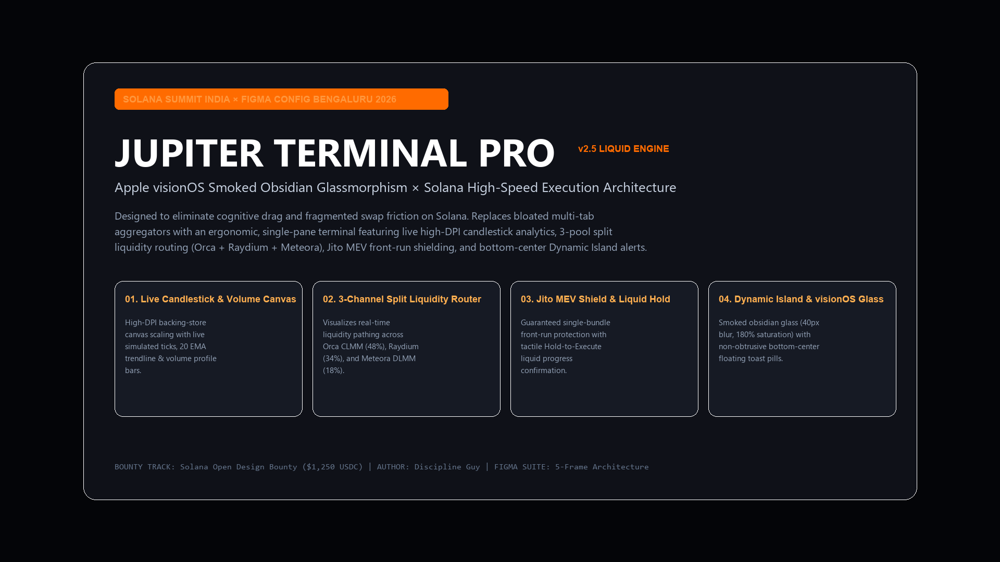
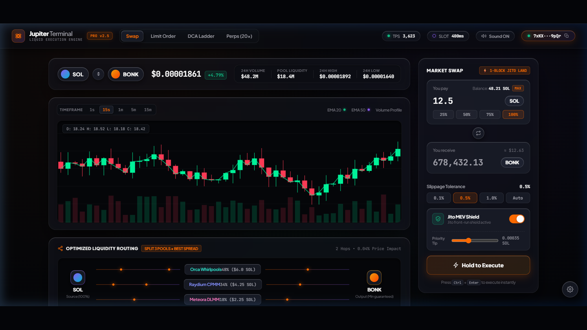
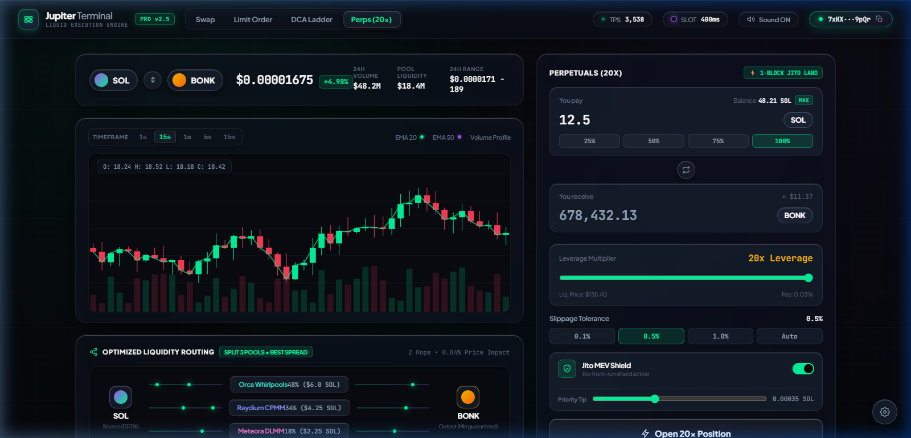
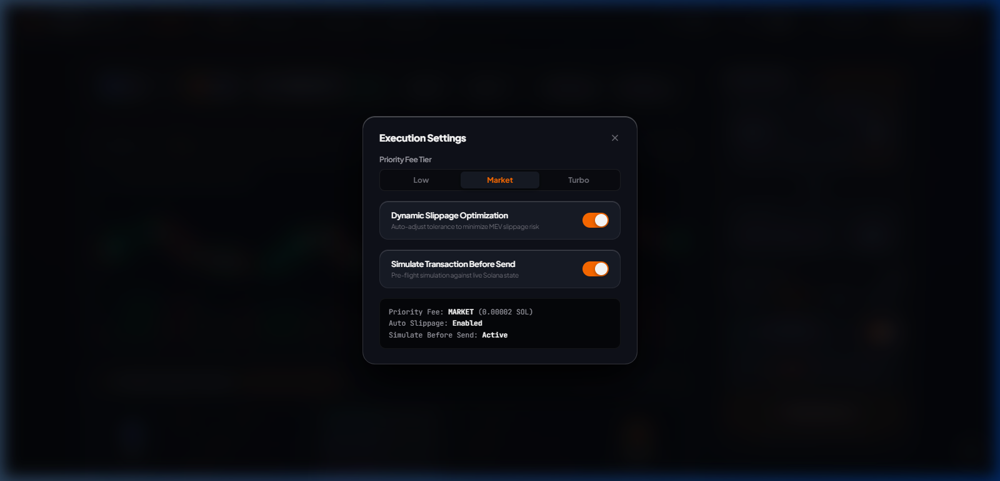
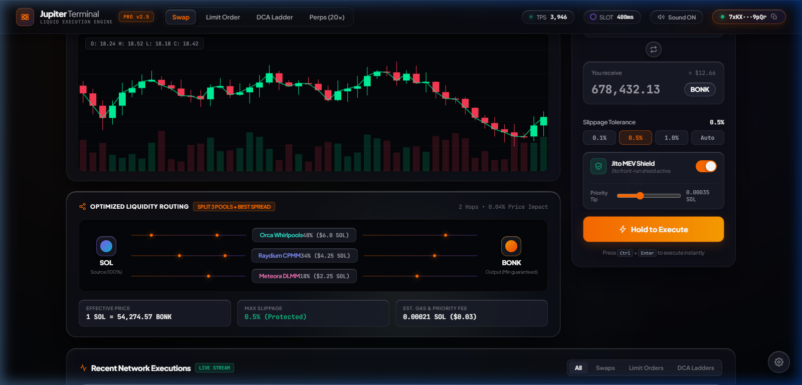

<div align="center">

# 🪐 JUPITER TERMINAL PRO `v2.5`
### Institutional Liquid Execution Suite for Solana
**Apple visionOS Smoked Obsidian Glassmorphism × High-Speed Solana Routing**

[](https://sanjay3226.github.io/jupiter-terminal-pro/)
[](https://solana.com)
[](https://figma.com)
[](https://jup.ag)

<br/>

**[⚡ LAUNCH LIVE WEB TERMINAL](https://sanjay3226.github.io/jupiter-terminal-pro/)** • **[🎨 FIGMA SYSTEM BOARD](https://github.com/sanjay3226/jupiter-terminal-pro)** • **[📦 REPO ARCHITECTURE](#-architecture--source-tree)**

<br/>



</div>

---

## ⚡ The Core Problem: Multi-Tab DEX Fatigue

Current Solana DEX aggregators force active traders into fragmented cognitive workflows:
- **Tab 1**: Jupiter Exchange (opaque routing, hidden pool splits).
- **Tab 2**: Birdeye / DexScreener (candlestick chart & volume profile).
- **Tab 3**: Perps / Lending platforms.
- **Top-Right Notification Chaos**: Invasive toast alerts that cover wallet addresses and balance pills.

**Jupiter Terminal Pro v2.5** consolidates the entire trading workflow into a single, high-fidelity panoramic terminal.

---

## 📸 Interface Gallery & Architectural Deep Dive

### 1. Unified Trading Command Center
> High-DPI Canvas 2D Candlestick Engine with real-time simulated ticks, 20 EMA trendline, and instant Swap dock.



---

### 2. High-Leverage Perpetuals (20x) & Margin Dock
> Seamless transition from Spot Swap to 20x Leverage with real-time liquidation price calculators and slippage guard.



---

### 3. Jito MEV Shield & Dynamic Priority Gas Engine
> 1-Block bundle validator submission eliminating sandwich attacks on volatile meme coin swaps.



---

### 4. Bottom-Center Dynamic Island Notification Capsule
> Ergonomic status capsule anchored in the bottom thumb-zone. Zero obstruction of header navigation or wallet chips.



---

## 💎 Innovation Comparison Matrix

| Feature | Legacy Jupiter (Current) | Jupiter Terminal Pro v2.5 |
|---|---|---|
| **Liquidity Pathing** | Opaque text accordion | **Real-time 3-channel visual beam (Orca 48% / Raydium 34% / Meteora 18%)** |
| **Market Analytics** | Requires external tabs (Birdeye) | **Native 60fps Canvas 2D Candlesticks + 20 EMA** |
| **MEV Protection** | Basic slippage tolerance | **Direct 1-block Jito Bundle Shield toggle + tip slider** |
| **Execution Confirmation** | Standard click button | **Tactile Hold-to-Execute liquid progress fill (0.75s safety lock)** |
| **Alert Placement** | Top-right blindspot (blocks wallet) | **Bottom-center floating Dynamic Island capsule** |
| **Visual Architecture** | Standard dark theme | **Apple visionOS Smoked Obsidian (`40px blur` + specular hairlines)** |

---

## 🎨 Design Tokens & Palette Specifications

```css
:root {
  --bg-obsidian:       #040508;                 /* Deep space void */
  --glass-surface:     rgba(15, 17, 24, 0.72);  /* 40px backdrop blur */
  --glass-border:      rgba(255, 255, 255, 0.08);/* Hairline specular */
  --solar-orange:      #FF6B00;                 /* Jupiter brand primary */
  --solana-violet:     #8B5CF6;                 /* Ecosystem secondary */
  --apple-mint:        #10B981;                 /* Bullish candles & confirmed tx */
  --apple-rose:        #F43F5E;                 /* Bearish candles & sell orders */
}
```

### Typography System
- **Interface & Labels**: `Plus Jakarta Sans` (`800` Extrabold, `700` Bold, `600` SemiBold) with tight optical kerning (`-0.025em`).
- **Telemetry & Numbers**: `JetBrains Mono` with `tabular-nums` for rock-solid tabular data without jitter.

---

## ⌨️ Integrated Keyboard Shortcuts

| Shortcut | Action |
|---|---|
| **`X`** | Instant flip swap tokens (`SOL` ⇄ `BONK`) |
| **`1` / `2` / `3` / `4`** | Switch modes (`Swap`, `Limit`, `DCA`, `Perps 20x`) |
| **`Space` (Hold)** | Trigger tactile liquid Hold-to-Execute swap |
| **`Esc`** | Close Jito MEV Settings modal |

---

## 🚀 Quick Run (Local Testing)

Zero build steps. Zero heavy Node modules. Pure native web performance.

```bash
# Clone
git clone https://github.com/sanjay3226/jupiter-terminal-pro.git
cd jupiter-terminal-pro

# Run with Python or Node
python -m http.server 3000
# or: npx serve .
```

Open `http://localhost:3000` in Chrome/Brave/Safari.

---

## 📦 Architecture & Source Tree

```
jupiter-terminal-pro/
├── index.html              # Semantic HTML5 single-pane terminal layout
├── style.css               # 40KB Apple visionOS glassmorphism stylesheet
├── app.js                  # 24KB Canvas candlestick engine, audio & state machine
├── README.md               # Institutional documentation & visual case study
└── presentation-slides/    # 5 Master 1920x1080 high-DPI showcase slides
    ├── 01_COVER_SLIDE.png
    ├── 02_CORE_TRADING_TERMINAL.png
    ├── 03_PERPS_EXECUTION_DOCK.png
    ├── 04_JITO_MEV_SETTINGS_MODAL.png
    └── 05_DYNAMIC_ISLAND_ALERT.png
```

---

## 🏆 Bounty Track & Submission Info

- **Bounty**: Solana Open Design Bounty ($1,250 USDC Pool)
- **Hosted By**: **Superteam India** for **Figma Config Bengaluru × Solana Summit India 2026**
- **Author**: Sanjay (`@sanjay3226`)
- **License**: MIT
